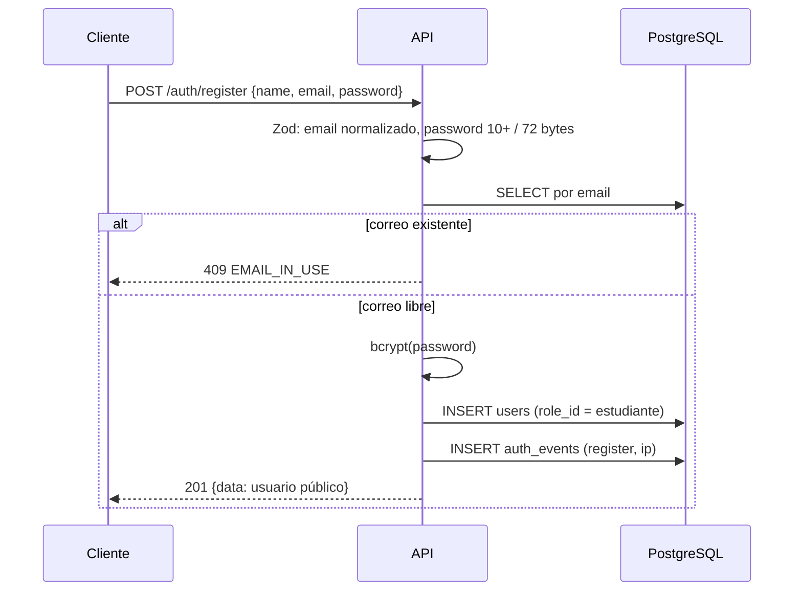
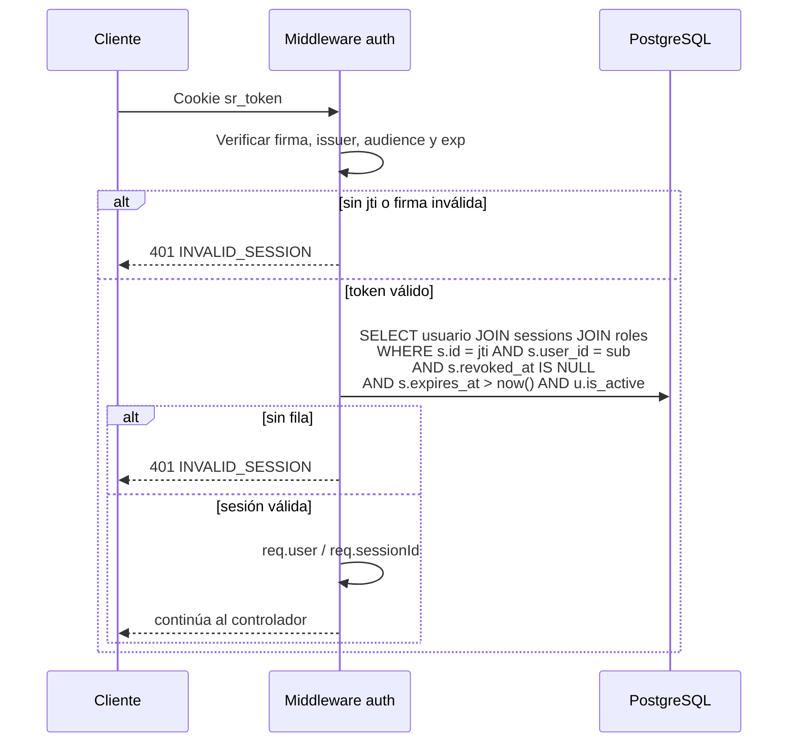
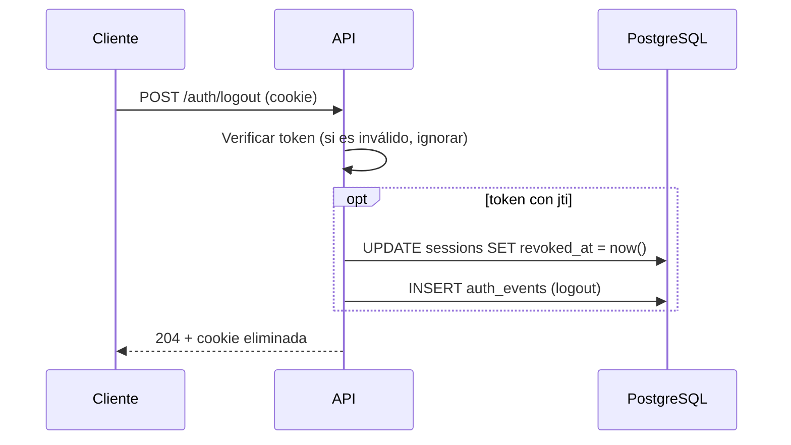
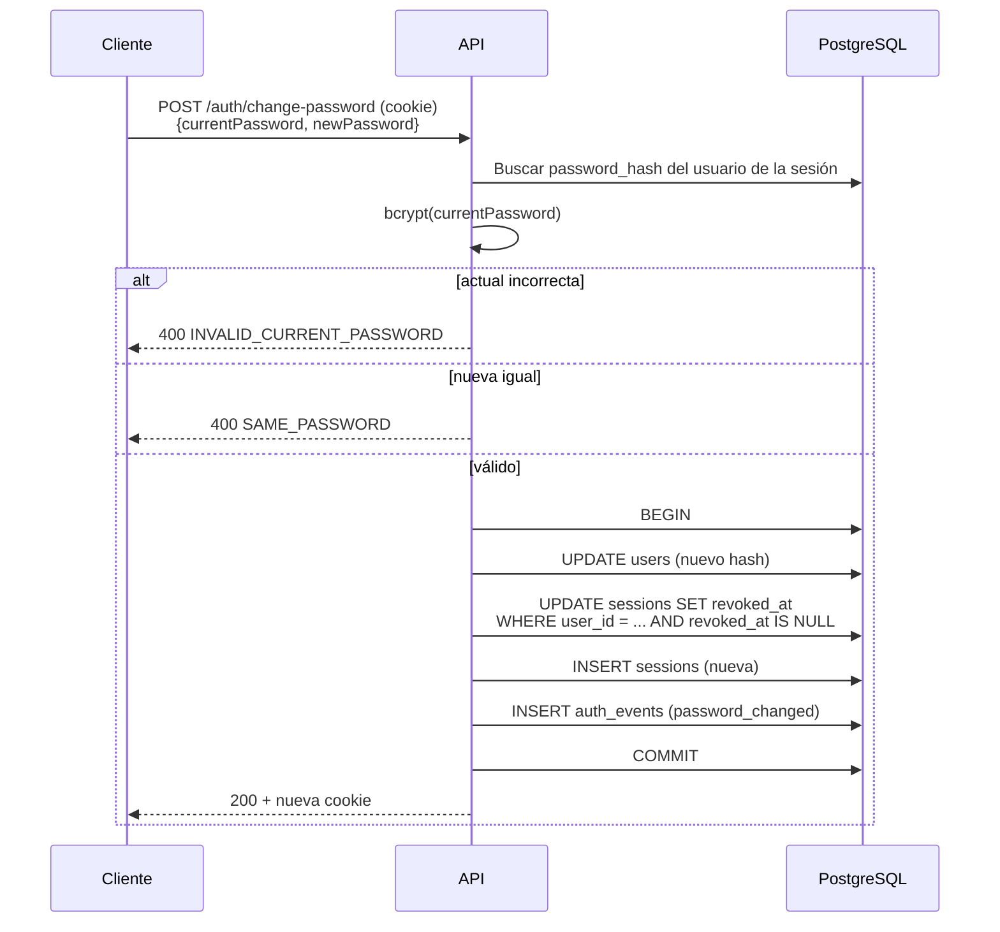

# Flujos de autenticación

Diagramas del comportamiento implementado. Las decisiones y la trazabilidad
están en [`matriz-cumplimiento-1-2.md`](matriz-cumplimiento-1-2.md); la
evidencia manual, en [`evidencia-auth.md`](evidencia-auth.md).

## 1. Registro



## 2. Login, bloqueo y sesión

```mermaid
flowchart TD
  S([POST /auth/login]) --> L[Buscar usuario por email]
  L --> H{¿Existe?}
  H -- No --> D[bcrypt contra hash ficticio]
  H -- Sí --> P[bcrypt contra hash real]
  D --> E[Registrar login_failed]
  P --> Q{¿Bloqueado, inactivo o clave mala?}
  Q -- Sí --> I{¿Estaba bloqueado?}
  I -- No --> J[Incremento atómico de failed_attempts]
  J --> K{¿Alcanzó el umbral?}
  K -- Sí --> K2[Calcular locked_until y registrar account_locked]
  K -- No --> K3[Registrar login_failed]
  K2 --> K3
  I -- Sí --> K3
  K3 --> R[401 INVALID_CREDENTIALS]
  Q -- No --> OK[Resetear failed_attempts y locked_until]
  OK --> S1[Crear fila en sessions]
  S1 --> S2[Firmar JWT con sub y jti = sessions.id]
  S2 --> S3[Set-Cookie HttpOnly/SameSite=Strict]
  S3 --> S4[Registrar login_success]
  S4 --> Z([200 {data: usuario público}])
```

Duración del bloqueo con `threshold = 5`:

| Fallos | `locked_until` |
| --- | --- |
| 5 | 60 s |
| 6 | 120 s |
| 7 | 240 s |
| 8 | 480 s |
| ≥ 9 | 900 s |

Mientras está bloqueada, la cuenta no incrementa el contador. La cookie se
reemplaza si el login trae una sesión válida del mismo usuario (rotación).

## 3. Petición autenticada



## 4. Logout y rotación



La revocación es inmediata: el mismo token devuelve `401` en `/auth/me` aunque
su `exp` siga vigente.

## 5. Cambio de contraseña



Todas las sesiones anteriores dejan de servir; solo la nueva cookie funciona.

## 6. Restablecimiento por correo

```mermaid
sequenceDiagram
  participant C as Cliente
  participant A as API
  participant D as PostgreSQL
  participant M as SMTP/Mailpit
  C->>A: POST /auth/forgot-password {email}
  A->>A: Generar token de 32 bytes y SHA-256
  A->>D: Buscar usuario activo
  alt existe y está activo
    A->>D: BEGIN; anular tokens pendientes; INSERT token_hash; evento; COMMIT
    A-->>M: Enviar enlace (sin esperar)
  end
  A-->>C: 202 (misma respuesta siempre)

  C->>A: POST /auth/reset-password {token, newPassword}
  A->>D: Buscar token_hash no usado y no vencido
  alt inválido, usado, vencido o cuenta inactiva
    A->>D: INSERT auth_events (password_reset_failed)
    A-->>C: 400 INVALID_RESET_TOKEN
  else válido
    A->>D: BEGIN
    A->>D: UPDATE users (hash, failed_attempts=0, locked_until=NULL)
    A->>D: Marcar token y pendientes como usados
    A->>D: Revocar todas las sesiones
    A->>D: INSERT auth_events (password_reset_completed)
    A->>D: COMMIT
    A-->>C: 200 (sin iniciar sesión)
  end
```

El enlace tiene la forma `FRONTEND_URL/restablecer#token=...`. El fragmento no
se envía al servidor; el frontend debe leerlo, limpiar la URL y enviarlo en el
cuerpo del `POST`.

## 7. Cookies y JWT

| Elemento | Valor |
| --- | --- |
| Cookie | `sr_token`, `HttpOnly`, `SameSite=Strict`, `Path=/`, `Secure` según entorno |
| Claims | `sub` (usuario), `jti` (sesión), `iss`, `aud`, `iat`, `exp` |
| Algoritmo | HS256 fijado al firmar y verificar |
| Duración | `JWT_EXPIRES_IN` (2 h por defecto) |
| Autoridad de caducidad | `sessions.expires_at > now()` en PostgreSQL |
